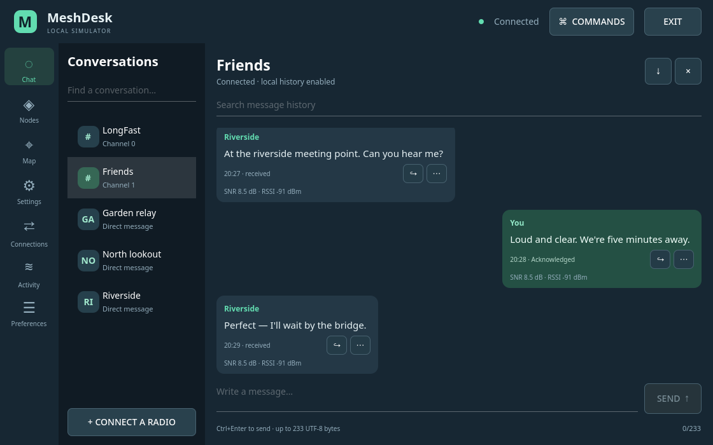
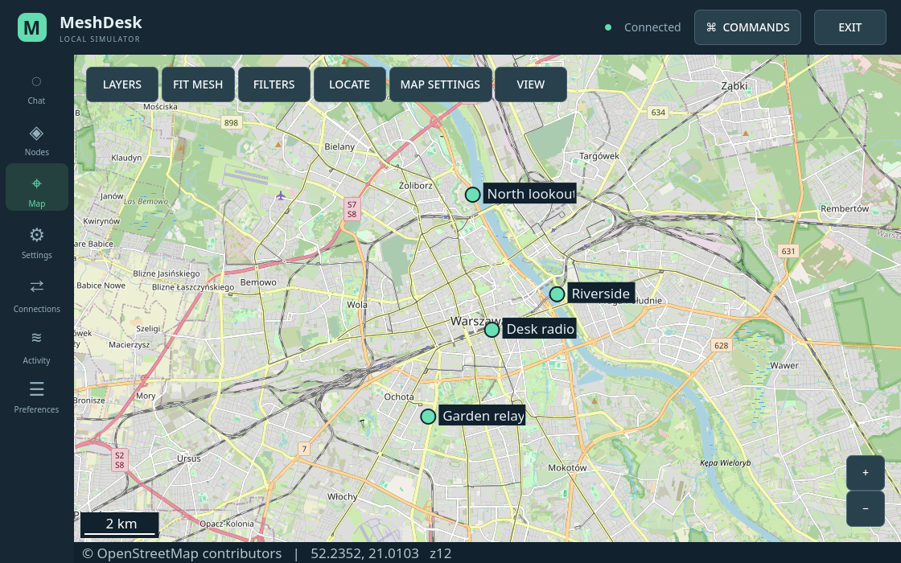
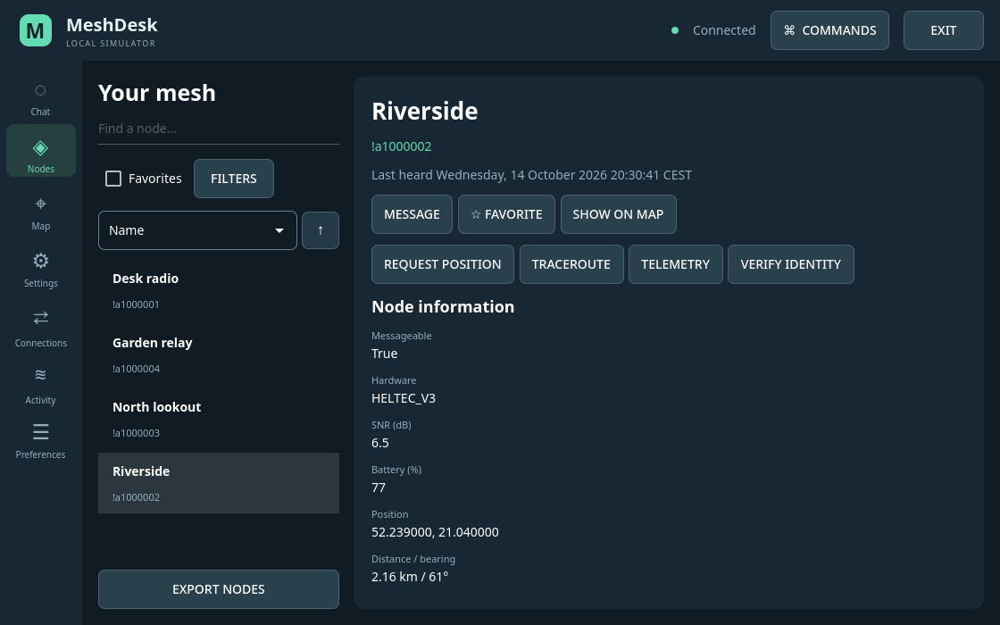
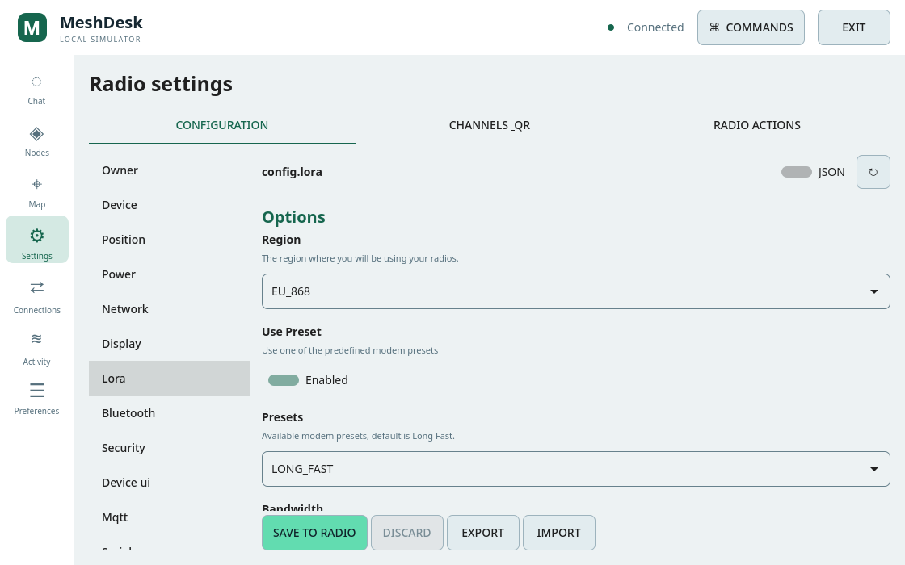

<div align="center">
  
  <h1>MeshDesk</h1>
  <p><strong>Your mesh, close at hand.</strong></p>
  <p>Message friends. See your mesh on a map. Manage your Meshtastic radio.</p>
  <p>
    <a href="https://github.com/plotter-doctor/MeshDesk/releases/latest"><strong>Download for Linux &amp; Windows</strong></a>
    &nbsp;·&nbsp; <a href="#get-started">Get started</a>
    &nbsp;·&nbsp; <a href="#take-a-look">Screenshots</a>
    &nbsp;·&nbsp; <a href="#technical-details">Technical details</a>
  </p>
</div>

MeshDesk is a free, open-source Meshtastic app for desktops and tablets. Chat,
find your nodes and adjust your radio in one place, with an interface designed
for both touch and mouse. Built to stay light, it runs on our tested ARM32 tablet
with just **1 GB of RAM**.

[](docs/screenshots/showcase/chat.png)

*Your conversations, channels and direct messages, together in one view.*

## Why MeshDesk?

- **Keep the conversation going.** Group chats, direct messages, replies and
  delivery status, with searchable history saved on your device.
- **See your mesh.** Find nodes on a map, check their signal and battery, and
  share meeting points with waypoints.
- **Make a small device useful.** A touch-friendly layout for compact tablets,
  with light and dark themes and an embedded keyboard on the tested ARM tablet.
- **Connect your way.** USB, Bluetooth LE or a network connection to your radio.
- **Keep control of your data.** No MeshDesk account or automatic telemetry.
  Map downloads are optional; previously cached tiles can be viewed offline.

Meshtastic radios carry the messages over the mesh. Internet access is needed
for new map tiles and online downloads, not for a local USB/Bluetooth radio link.

## Get started

**[Get the latest release →](https://github.com/plotter-doctor/MeshDesk/releases/latest)**

| Your device | What to download | How to open it |
| --- | --- | --- |
| Ubuntu desktop or ARM32 tablet | The `.deb` package | Follow the [Ubuntu installation guide](docs/DEBIAN.md), then open **MeshDesk** from your applications menu. |
| Windows 10/11, 64-bit | The `windows-x86_64.zip` archive | Extract the whole ZIP, open the **MeshDesk** folder and double-click **MeshDesk.exe**. [Windows guide](docs/WINDOWS.md) |

1. **Plug in your Meshtastic radio.** USB is a good place to start.
2. **Open Connections.** Choose USB/serial, click **Discover**, select your radio
   and click **Connect radio**.
3. **Start exploring.** Open **Chat** to send a message, **Nodes** to see your
   devices, or **Map** to view their reported positions.

Use **Preferences → Download map tiles** to add a basemap when you have internet
access. Keep the map download setting off when you only want cached tiles.

<details>
<summary><strong>No radio handy? Try the demo.</strong></summary>

The built-in demo lets you explore the app with simulated nodes and messages.
It does not transmit over radio. After installing, launch from a terminal:

```sh
meshdesk --demo
```

On Windows, open a terminal in the extracted MeshDesk folder and run
`./MeshDesk.exe --demo`.

</details>

## Take a look

### Find your mesh on the map

See where nodes are, explore their surroundings and keep useful places close
at hand with waypoints.

[](docs/screenshots/showcase/map.png)

<table>
  <tr>
    <td width="50%"><strong>Know your nodes</strong><br>Signal, battery and useful actions in one place.</td>
    <td width="50%"><strong>Make your radio your own</strong><br>Clear settings forms, with a light theme when you prefer it.</td>
  </tr>
  <tr>
    <td><a href="docs/screenshots/showcase/nodes.png"></a></td>
    <td><a href="docs/screenshots/showcase/settings-light.png"></a></td>
  </tr>
</table>

*Actual application screenshots with fictional demo messages and nodes. Click
any screenshot to see it full size. Map data © [OpenStreetMap contributors](https://www.openstreetmap.org/copyright).*

## Help and feedback

Found a problem or have an idea? **[Open an issue](https://github.com/plotter-doctor/MeshDesk/issues)**
and tell us your operating system, MeshDesk version and what happened. Please
remove private messages, radio addresses and keys from any logs you share.

MeshDesk is an independent community client, not an official Meshtastic product.

---

## Technical details

The sections below cover platform support, installation from source, feature
coverage, data storage and development.

- [Compatibility and validation](#compatibility-and-validation)
- [Package installation](#package-installation)
- [Run from source](#run-from-source)
- [Feature reference](#feature-reference)
- [Data and privacy](#data-and-privacy)
- [Development and tests](#development-and-tests)
- [Licence](#licence)

### Compatibility and validation

MeshDesk uses Qt Quick 5, the official Meshtastic Python library and SQLite.
Its default software renderer suits the ARMv7 / 1 GB Ubuntu tablet; no browser
engine is embedded.

| Platform | Validation |
| --- | --- |
| ARM32 / ARMv7, Ubuntu 22.04 | Installed and tested on the 1 GB tablet, including its embedded keyboard and window sizing. |
| Ubuntu x86-64: 22.04, 24.04, 25.04, 25.10 | Automated installed-package, simulator, keyboard (where available) and window checks. |
| Windows 10/11 x86-64 | Portable package targets these versions; automated GUI and executable tests run on Windows Server 2025. Physical Windows radio acceptance remains separate. |

Ubuntu 25.x is end of life; prefer an LTS release for ongoing OS security updates.
Ubuntu 25.04 does not supply Qt's embedded keyboard packages, so use the desktop's
on-screen keyboard there. The Windows ZIP is unsigned and bundles a legacy Qt
5.15.2 / OpenSSL 1.1.1b runtime; see the [Windows guide](docs/WINDOWS.md).
No macOS, Android or iOS package is supplied.

The configuration audit maps **210/210 controls** in official web **v2.7.2**:
207 use generated native form metadata and three use fixed-position actions.
This is configuration-form coverage, not a claim of complete hardware acceptance.
See [feature coverage](docs/FEATURES.md), [measured results](docs/VALIDATION.md)
and [testing and GUI review](docs/TESTING.md).

### Package installation

Download the package from [Releases](https://github.com/plotter-doctor/MeshDesk/releases/latest).
The same Debian package serves the ARM32 tablet and x86-64 Ubuntu desktops:

```sh
sudo apt install ./meshdesk_0.3.0-1_all.deb
meshdesk
```

For Windows, extract the complete ZIP and run `MeshDesk.exe`. Keep its `_internal`
folder beside the executable. No separate Python installation is needed.

See [Debian packages and releases](docs/DEBIAN.md) and
[Windows installation](docs/WINDOWS.md) for dependencies, upgrades and build details.

### Run from source

Install the distribution's ARM Qt packages for the source checkout. This
installation has been exercised on the target tablet.

```sh
sudo apt install python3-venv python3-pip python3-pyqt5 python3-pyqt5.qtquick \
  python3-cryptography qml-module-qtquick2 \
  qml-module-qtquick-window2 qml-module-qtquick-layouts \
  qml-module-qtquick-controls2 qml-module-qtquick-templates2 \
  qml-module-qtgraphicaleffects qml-module-qtquick-virtualkeyboard qtvirtualkeyboard-plugin \
  qml-module-qt-labs-folderlistmodel \
  fonts-noto-color-emoji fonts-noto-cjk
./scripts/bootstrap.sh
./run.sh --demo
```

QtPrintSupport is included in the PyQt5 distribution. Optional computer-location
support uses `python3-pyqt5.qtpositioning` and an OS location provider. Bluetooth
needs BlueZ and an available adapter; serial access normally needs membership of
the `dialout` group. Re-login after changing group membership. Use an OS on-screen
keyboard on touch devices, or the embedded keyboard enabled automatically on ARM
when Qt Virtual Keyboard is installed (`--keyboard on|off|auto`). The existing tablet graphics driver is not accelerated;
keep the default software renderer until graphics support changes.

The protobuf dependency has a pure-Python wheel for ARM32. That backend was
tested on ARM32: approximately 80 MiB peak sampled idle RSS and 94 MiB for
500 nodes plus 5,000 stored messages. These are short, reproducible samples. Qt and
cryptography receive updates through the distribution; SDK dependencies are
constrained in `requirements-linux.lock`.
The bootstrap script disables optional D-Bus Cython extensions on ARM32 and also
uses any dependency wheels supplied in `dist/`.

On other desktop systems, use a Python 3.10–3.14 virtual environment,
install `pip install -e '.[desktop]'` and run `meshdesk`.

#### Demo and connection controls

```sh
./run.sh --demo
```

The simulator speaks the official TCP/protobuf protocol and echoes messages.
Use `--demo-transport serial` for a POSIX virtual serial port, or
`--demo-transport ble` for an in-process Bleak GATT peripheral. It never
transmits over LoRa.

For a real radio, run `./run.sh`, open Connections and choose USB/serial, TCP,
HTTP(S) or Bluetooth LE. Discovery shows compatible USB devices by default;
**Show all serial ports** includes other hardware. Selection closes the picker.
The main Connect button becomes Disconnect for the selected active endpoint.
Multiple connections can remain active; select a connection to change the
mesh displayed. **Exit** remains available at the top right on every page.

### Feature reference

- Chat: channels, direct messages, replies, delivery acknowledgements, unread
  counts, search, paged history, copy/delete and export.
- Nodes: names, signal, battery, position, distance, filters, favorites, ignore,
  removal/key refresh, position requests, traceroute and identity verification.
- Map: native raster tiles, cached offline content, node/waypoint markers,
  neighbor links, position precision, density/SNR overlays, pan/pinch/zoom and
  location controls. Internet tile fetching starts disabled.
- Settings: read a section, edit a draft, then explicitly save. Writes wait for
  acknowledgement and readback. JSON import/export handles advanced fields.
  Drafts survive page navigation and can be committed together. Selected channels
  can be shared by URL/QR and imported into chosen slots, with optional LoRa
  settings and explicit replacement controls. Identity keys can
  be generated, backed up or printed. Radio actions include fixed position,
  canned messages, ringtone, time, reboot/shutdown with cancellation, OTA reboot, DFU and resets.
- Activity: diagnostics, telemetry, traceroute responses and key-verification
  prompts. The header indicator opens pending notifications.
- Preferences: automatic/dark/light theme, clock, 22 official translation catalogs
  with native UI translations, map source and
  manual official-release checks. Ctrl+K opens commands; Ctrl+1–4 switches pages.

Settings changes that restart firmware may disconnect the radio before readback;
the application reports an unknown/different outcome instead of claiming a
verified save. Reconnect and reload before retrying. Batch saves and channel imports use firmware begin/commit-edit commands to defer
restarts. This is not an atomic rollback transaction: a failure can leave a subset
of changes applied. Unconfirmed drafts remain available for inspection.

### Data and privacy

Local state lives in Qt's application-data directory (normally
`~/.local/share/MeshDesk/MeshDesk/` on Linux). Override it with `--data-dir PATH`.
Messages and nodes are scoped to a connection; schema version 1 uses SQLite WAL.
The directory is owner-only and database/exports use mode 0600. The database is
not encrypted. Admin session passkeys are excluded from stored packet/node data.
Channel keys and private keys are exported only through explicit user actions.

There is no automatic release check or telemetry. Map fetching and checking
official releases are explicit actions. Tile providers receive tile requests;
nodes are overlaid locally. Never share identity backups publicly.

### Development and tests

```sh
PYTHONNOUSERSITE=1 .venv/bin/python -m pip install -e '.[test]'
PYTHONNOUSERSITE=1 xvfb-run -a .venv/bin/python -m pytest -q --cov --cov-report=html --cov-report=json:artifacts/coverage.json
.venv/bin/python tools/check_coverage.py artifacts/coverage.json
PYTHONNOUSERSITE=1 .venv/bin/python tools/audit_compatibility.py
```

Tests exercise the real official SDK over TCP, HTTP and a POSIX pseudo terminal;
read/write every settings section; test message ACKs/replies, errors, isolation
and reconnection; and operate the actual QML window. Set `MESHDESK_ARTIFACTS` to
save screenshots. They do not emulate RF propagation, encryption or firmware
reboots. [Architecture and upgrades](docs/UPGRADING.md) explain the update process.

For an opt-in physical USB test, close other applications using the serial port:

```sh
PYTHONNOUSERSITE=1 .venv/bin/python tools/hardware_smoke.py \
  --port /dev/ttyACM0 --data-dir /tmp/meshdesk-hardware \
  --output artifacts/hardware.json
```

This reads configuration, opens all seven screens and reconnects without
changing radio settings. Add `--recipient '!FULLNODEID' --message 'Test message'`
to explicitly enable one private message; the tool requires a unique known
remote node and verifies the acknowledgement's sender and request ID. Optional
`--probe telemetry --probe traceroute` enables directed read requests to that
recipient. `--keep-open` leaves the connected GUI open after success. Reports
exclude keys and configuration values. See [hardware results](docs/VALIDATION.md).

To add a Linux application-menu entry for this checkout, run
`./scripts/install-desktop.sh`. Build a wheel and source kit with
`.venv/bin/python tools/build_release.py`.

### Licence

Copyright 2026 MeshDesk contributors. Licensed under [GPL-3.0-only](LICENSE).
Meshtastic and its official web translations remain the work of their respective
contributors; see [THIRD_PARTY.md](THIRD_PARTY.md).
