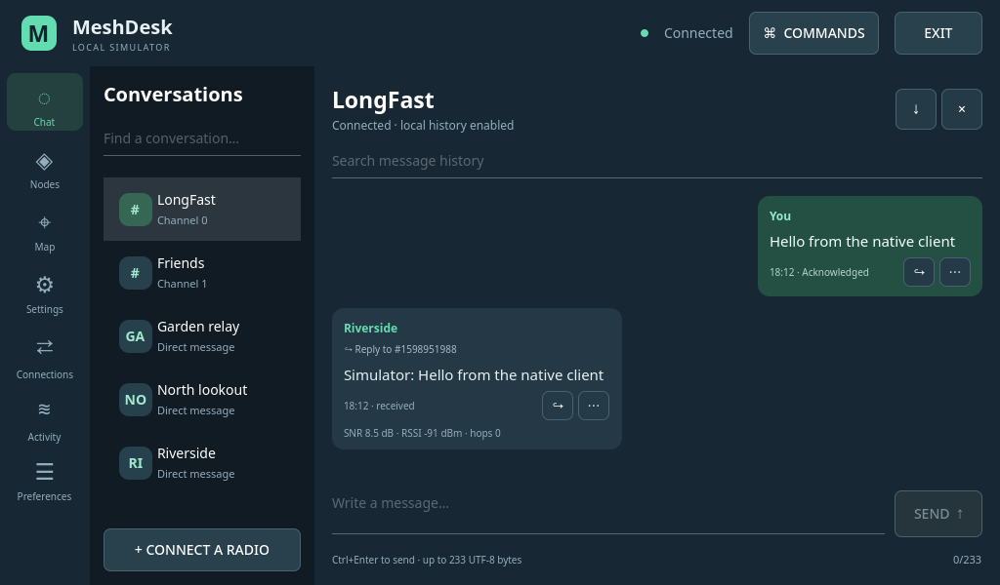
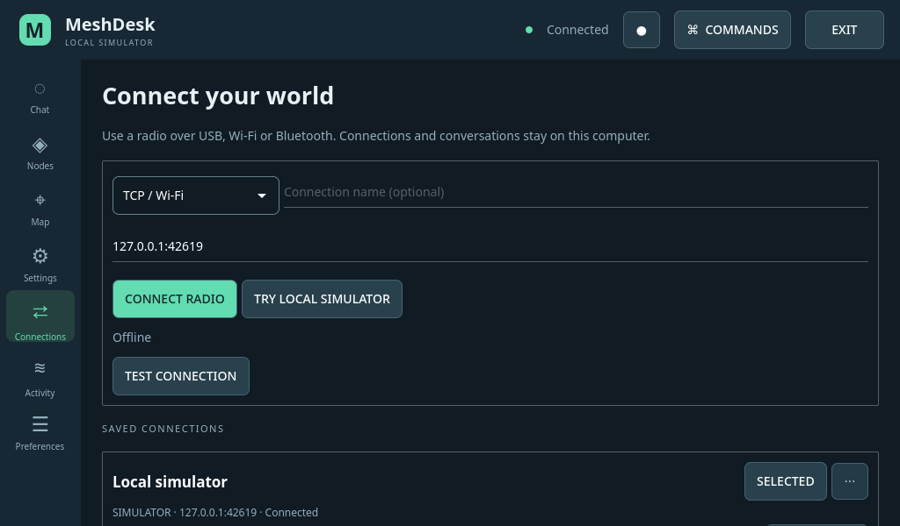
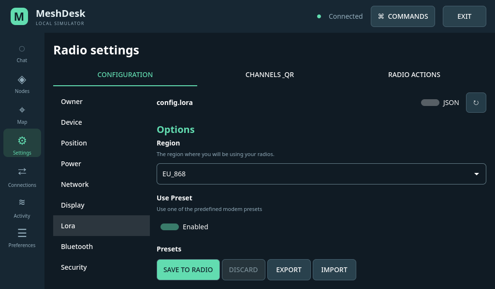
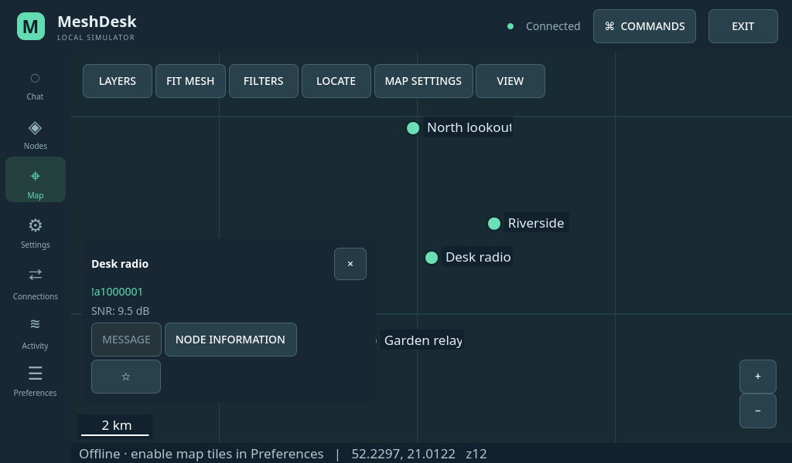

# Validation evidence

The pre-release x86-64 Linux suite for 0.3.0 passed **181 tests, 4 skipped** on
14 October 2026. Statement coverage was **99.37% (2506/2522)** and branch coverage
**96.01% (1035/1078)**. The skipped cases require Openbox (three decorated-window
checks) or the opt-in Qt Virtual Keyboard runtime. The release jobs install these
components and run installed-package keyboard and window checks separately.

GitHub Actions retains JUnit reports, coverage reports, screenshots and package
validation reports for each run. The tagged release must pass its own checks;
these local measurements are not a substitute for the tagged run's result.
See [Actions](https://github.com/plotter-doctor/MeshDesk/actions) and
[testing instructions](TESTING.md) for reproduction.

## GUI and stability

The GUI suite exercises seven pages, three screen sizes (including 1024×600),
English/dark and Polish/light, all settings sections, dialogs and populated
states. It checks 604 rendered states across the layout and variant sweeps.
It rejects control overlaps, clipping, QML errors and binding loops. Map tests
exercise garbage collection during pending tile downloads and page destruction.
Decorated-window tests include desktop panels, startup, maximize and restore.
The Exit action, discovery selection and Connect/Disconnect state are exercised
through the actual QML window. QML behavior is measured separately from Python
coverage. Geometry tests cannot certify every translation, gesture or OS scale.

The screenshots below contain synthetic simulator data:

## ARM tablet and physical radio

The target is a 1 GB ARMv7 tablet running standard Ubuntu 22.04 with a 1024×600
LXQt/Openbox desktop and software rendering. Previous package checks passed
TCP, pseudo-terminal serial and in-process BLE simulations, embedded keyboard
input, all-page geometry, package integrity and Exit tapping. The 0.3.0 release
candidate also passed these installed-package checks on this tablet.

Prior measured tablet samples were approximately **80 MiB peak idle RSS** with
the keyboard module, and **94 MiB** with 500 nodes and 5,000 stored messages.
These short samples are not a memory ceiling. With 500 nodes, page changes took
about 0.8–1.4 seconds and individual typing events remained below 27 ms.

A physical USB radio completed configuration reads, acknowledged private
messages, directed telemetry/traceroute requests and reconnection. Host Bluetooth
pairing succeeded, but full physical BLE synchronization remains unverified.
Raw hardware records, private addresses, messages and identity data are retained
locally and excluded from the public repository.

## Release packages

One architecture-independent Debian package bundles pinned pure-Python SDK
libraries; each distribution supplies native Qt and cryptography. CI installs it
in clean Ubuntu 22.04, 24.04, 25.04 and 25.10 x86-64 containers, tests three
simulator transports, taps the embedded keyboard and checks a decorated window
under Openbox. Actual ARM validation is performed on the tablet.

Windows CI runs portable Python tests, then separately builds a self-contained
executable and launches it without checkout imports using offline, TCP and BLE
simulations. This verifies packaging and GUI startup on the runner. Physical
Windows radios, OS Bluetooth pairing and every Windows desktop version remain
separate acceptance work. No macOS package is part of this release.

The [feature matrix](FEATURES.md) distinguishes configuration-form parity from
hardware acceptance; neither code coverage nor simulator results establishes
100% real-world behavior.
